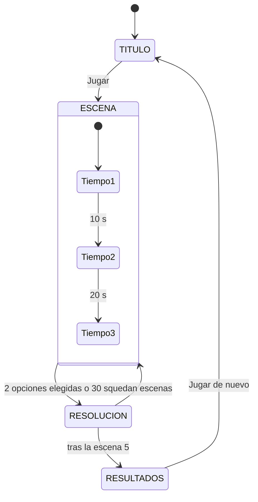
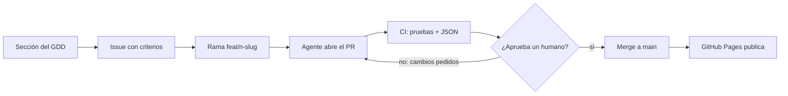

# GDD — Grito en Tiempo Real

> Prototipo de quiz en tiempo real sobre la Independencia de México
> Versión 0.1 · 2026-11-24 · Ruta sugerida en el repo: `docs/GDD.md`

---

## 1. Resumen del juego

**Grito en Tiempo Real** (título de trabajo) es un quiz web de una sola ronda: 5 escenas de la Independencia de México que *suceden mientras respondes*. Cada escena dura 30 segundos; el evento avanza en pantalla y, cuando termina, se cierra la respuesta.

**Pitch:** "La historia no te espera. Responde mientras arde la Alhóndiga."

| Atributo | Valor |
| --- | --- |
| Género | Quiz narrativo en tiempo real |
| Plataforma | Navegador (escritorio y móvil), publicado en GitHub Pages |
| Jugadores | 1 |
| Duración de una partida | 3 a 4 minutos (5 escenas de 30 s + transiciones) |
| Público | Secundaria y bachillerato; también alumnos del curso como jugadores de prueba |
| Tecnología | HTML5, CSS y JavaScript (módulos ES), sin motor ni build |

**Objetivos de aprendizaje del juego:** que el jugador ubique 5 momentos clave de 1810 a 1821, asocie a cada uno con sus protagonistas y distinga datos reales de anacronismos comunes.

**Objetivos del ejercicio de clase:** que el equipo practique documentar con un GDD, convertirlo en issues, trabajar con ramas y Pull Requests en GitHub, y coordinar agentes de IA con revisión humana.

**Alcance del prototipo (sí entra):** 1 ronda de 5 preguntas, temporizador por escena, puntuación, pantalla de resultados, arte provisional.

**Fuera de alcance:** multijugador, cuentas de usuario, tabla de récords en línea, más rondas, doblaje profesional.

---

## 2. Mecánicas

El jugador elige **2 de 4 opciones** mientras la escena avanza; responder antes vale más, pero esperar revela pistas.

### 2.1 Regla de respuesta

- Cada pregunta tiene 4 opciones: **2 correctas** y **2 distractores** (diseñados para engañar con anacronismos o personajes de otra etapa).
- El jugador marca 2 opciones; al marcar la segunda se confirma sola. Puede desmarcar la primera antes de elegir la segunda.
- El orden de las opciones se baraja en cada partida.

### 2.2 Tiempo real: la escena es el reloj

Cada escena dura **30 s** y se divide en 3 tiempos de 10 s. En cada tiempo cambia la ilustración, avanza la narración y aparece una pista nueva. La pregunta y las opciones están visibles desde el segundo 0.

| Tiempo | Segundos | Lo que pasa en pantalla | Multiplicador |
| --- | --- | --- | --- |
| 1. Inicio | 0–10 | Se presenta el lugar y la fecha | x3 |
| 2. Tensión | 10–20 | El evento se desarrolla; pista 1 | x2 |
| 3. Clímax | 20–30 | El momento decisivo; pista 2 | x1 |

Al llegar a 30 s sin respuesta, la escena termina, se cuenta como 0 puntos y se pasa a la resolución.

### 2.3 Puntuación

| Resultado | Puntos base |
| --- | --- |
| 2 correctas | 100 |
| 1 correcta + 1 distractor | 25 |
| 0 correctas o sin respuesta | 0 |

Puntos de la escena = puntos base × multiplicador del tiempo en que se confirmó. Máximo por partida: 5 × 300 = **1500**.

| Rango final | Puntos |
| --- | --- |
| Insurgente de honor | 1200–1500 |
| Capitán trigarante | 700–1199 |
| Recluta de Dolores | 300–699 |
| Cronista despistado | 0–299 |

### 2.4 Resolución de cada escena (5 s)

Se marcan en verde las 2 correctas y en rojo los distractores elegidos, se muestran los puntos ganados y un **dato histórico** de una línea.

### 2.5 Opciones de accesibilidad

- Teclas 1–4 para elegir opción.
- **Modo calma:** escenas de 45 s (tiempos de 15 s), mismos multiplicadores.
- Narración siempre en texto; el audio es opcional.

---

## 3. Contenido: las 5 escenas

La ronda recorre la guerra en orden cronológico, de la conspiración de 1810 a la consumación de 1821. Los distractores usan personajes reales fuera de su época para que el error enseñe algo.

| # | Escena | Fecha | Lugar |
| --- | --- | --- | --- |
| 1 | La conspiración descubierta | Septiembre de 1810 | Querétaro |
| 2 | El Grito de Dolores | 16 de septiembre de 1810 | Dolores, Guanajuato |
| 3 | La toma de la Alhóndiga de Granaditas | 28 de septiembre de 1810 | Guanajuato |
| 4 | El Congreso de Chilpancingo | Septiembre–noviembre de 1813 | Chilpancingo |
| 5 | La entrada del Ejército Trigarante | 27 de septiembre de 1821 | Ciudad de México |

### Escena 1 — La conspiración descubierta

- **Tiempo 1:** En Querétaro, un grupo se reúne fingiendo tertulias literarias.
- **Tiempo 2 (pista):** La conspiración es descubierta y la corregidora queda encerrada en su casa.
- **Tiempo 3 (pista):** Aun encerrada, logra enviar el aviso que llega a Dolores.
- **Pregunta:** ¿Quiénes formaban parte de la conspiración de Querétaro?
- **Correctas:** Josefa Ortiz de Domínguez · Ignacio Allende
- **Distractores:** Agustín de Iturbide (en 1810 combatía del lado realista) · Benito Juárez (en 1810 era un niño de 4 años)
- **Dato histórico:** El aviso de la corregidora obligó a adelantar el levantamiento planeado.

### Escena 2 — El Grito de Dolores

- **Tiempo 1:** Madrugada del 16 de septiembre de 1810; el pueblo de Dolores duerme.
- **Tiempo 2 (pista):** Suenan las campanas de la parroquia.
- **Tiempo 3 (pista):** El cura habla a la multitud reunida en el atrio.
- **Pregunta:** ¿Qué ocurrió esa madrugada en Dolores?
- **Correctas:** Miguel Hidalgo hizo sonar la campana para reunir al pueblo · Hidalgo llamó a levantarse contra el mal gobierno
- **Distractores:** Se leyó el Acta de Independencia del Imperio Mexicano (es de 1821) · José María Morelos encabezó el llamado (se unió al movimiento semanas después)
- **Dato histórico:** Hidalgo tomó como estandarte una imagen de la Virgen de Guadalupe en Atotonilco.

### Escena 3 — La toma de la Alhóndiga de Granaditas

- **Tiempo 1:** El ejército insurgente llega a Guanajuato.
- **Tiempo 2 (pista):** Los españoles se atrincheran en el granero de la ciudad con el intendente Riaño.
- **Tiempo 3 (pista):** Un minero con una losa en la espalda avanza hacia la puerta con una antorcha.
- **Pregunta:** ¿Qué sucedió en la Alhóndiga de Granaditas?
- **Correctas:** Los realistas y españoles se refugiaron dentro con el intendente Riaño · Según la tradición, "El Pípila" incendió la puerta
- **Distractores:** Ocurrió en el puerto de Veracruz · Fue la batalla que puso fin a la guerra
- **Dato histórico:** Los historiadores discuten si El Pípila existió tal como lo cuenta la tradición; el juego lo presenta como tradición.

### Escena 4 — El Congreso de Chilpancingo

- **Tiempo 1:** 1813; Hidalgo ya fue fusilado y Morelos dirige la insurgencia.
- **Tiempo 2 (pista):** Se reúnen diputados de varias provincias en el primer congreso insurgente.
- **Tiempo 3 (pista):** Se lee un documento con los principios de la nueva nación.
- **Pregunta:** ¿Qué pasó en el Congreso de Chilpancingo?
- **Correctas:** Morelos presentó los Sentimientos de la Nación · Se declaró la independencia de la América Septentrional
- **Distractores:** Miguel Hidalgo presidió el congreso (murió en 1811) · Se proclamó emperador a Iturbide (ocurrió en 1822)
- **Dato histórico:** El Acta Solemne de la Declaración de Independencia se firmó el 6 de noviembre de 1813.

### Escena 5 — La entrada del Ejército Trigarante

- **Tiempo 1:** 27 de septiembre de 1821; un ejército con bandera de tres colores llega a la capital.
- **Tiempo 2 (pista):** Recuerdo: en febrero se firmó el Plan de Iguala con tres garantías.
- **Tiempo 3 (pista):** Un antiguo jefe realista y un jefe insurgente del sur encabezan la alianza.
- **Pregunta:** ¿Qué líderes unieron fuerzas para formar el Ejército Trigarante?
- **Correctas:** Agustín de Iturbide · Vicente Guerrero
- **Distractores:** Miguel Hidalgo (murió en 1811) · José María Morelos (murió en 1815)
- **Dato histórico:** Al día siguiente, el 28 de septiembre de 1821, se firmó el Acta de Independencia del Imperio Mexicano.

**Validación del contenido:** el agente de contenido propone textos; un humano del equipo verifica cada dato contra una fuente (libro de texto SEP, INEHRM o similar) y la anota en el JSON antes de aprobar el PR.

---

## 4. Interfaz, arte y audio

La escena ocupa la pantalla y la pregunta vive encima de ella, como subtítulo de película: el evento nunca se tapa.

### 4.1 Pantallas

1. **Título:** logo, botón Jugar, interruptor Modo calma, interruptor de audio.
2. **Escena:** ilustración de fondo (cambia en cada tiempo), barra de tiempo arriba con 3 segmentos y el multiplicador actual, caja de narración, pregunta y 4 botones de opción abajo (2 × 2 en escritorio, 1 columna en móvil).
3. **Resolución:** opciones coloreadas, puntos de la escena, dato histórico.
4. **Resultados:** puntuación total, rango, resumen de las 5 escenas y botón Jugar de nuevo.

### 4.2 Dirección de arte

- Estilo: grabado o litografía del siglo XIX, plano y con textura de papel; paleta sepia con acentos verde, blanco y rojo solo para la interfaz.
- 3 ilustraciones por escena (una por tiempo): 15 en total. En el prototipo pueden ser bocetos o siluetas.
- Tipografías libres: una con serifa para títulos y una sans legible para opciones.
- Retroalimentación: verde = correcta, rojo = distractor elegido, además de un icono (✓ / ✗) para no depender solo del color.

### 4.3 Audio

- 1 pista ambiental por escena (campanas en Dolores, multitud en Guanajuato, marcha en la capital).
- Efectos: cambio de tiempo, selección, acierto, error, fin de escena.
- Usar solo audio propio o con licencia libre (CC0 o CC BY) y registrar la fuente en `assets/CREDITS.md`.

---

## 5. Arquitectura técnica

JavaScript puro con módulos ES, sin dependencias ni paso de compilación: se abre `index.html` con un servidor local y se publica igual en GitHub Pages. Así los agentes y los alumnos tocan archivos pequeños y fáciles de revisar.

### 5.1 Estructura del repositorio

```text
grito-en-tiempo-real/
├─ index.html
├─ css/styles.css
├─ src/
│  ├─ main.js            # arranque y bucle principal
│  ├─ game/state.js      # máquina de estados
│  ├─ game/timer.js      # reloj de escena y tiempos
│  ├─ game/scoring.js    # reglas de puntuación (funciones puras)
│  ├─ ui/render.js       # dibuja cada pantalla en el DOM
│  └─ ui/input.js        # clic, toque y teclas 1-4
├─ data/questions.json  # las 5 escenas
├─ assets/img/ · assets/audio/ · assets/CREDITS.md
├─ tests/scoring.test.js · tests/questions.test.js
├─ docs/GDD.md · docs/adr/ · docs/prompts.md
├─ scripts/setup-github.mjs · scripts/issues.json   # crea repo, issues y milestones
├─ README.md · CONTRIBUTING.md
├─ AGENTS.md            # reglas para cualquier agente de IA
├─ CLAUDE.md            # Claude Code: importa AGENTS.md
└─ .github/
   ├─ copilot-instructions.md
   ├─ ISSUE_TEMPLATE/tarea.yml · bug.yml
   ├─ pull_request_template.md
   └─ workflows/ci.yml · pages.yml   # pruebas y publicación
```

### 5.2 Máquina de estados



- El reloj usa `performance.now()` dentro de `requestAnimationFrame`, no `setInterval`, para que el tiempo no se desfase.
- Si la pestaña se oculta (`visibilitychange`), la escena se pausa.
- `scoring.js` no toca el DOM: recibe las opciones elegidas y el tiempo, y devuelve los puntos. Así se prueba con `node --test`.

### 5.3 Esquema de datos de una escena

```json
{
  "id": "alhondiga",
  "titulo": "La toma de la Alhóndiga de Granaditas",
  "fecha": "1810-09-28",
  "lugar": "Guanajuato",
  "tiempos": [
    { "narracion": "El ejército insurgente llega a Guanajuato.", "imagen": "assets/img/alhondiga-1.webp" },
    { "narracion": "Los españoles se atrincheran con el intendente Riaño.", "imagen": "assets/img/alhondiga-2.webp" },
    { "narracion": "Un minero avanza con una antorcha hacia la puerta.", "imagen": "assets/img/alhondiga-3.webp" }
  ],
  "pregunta": "¿Qué sucedió en la Alhóndiga de Granaditas?",
  "opciones": [
    { "texto": "Los realistas se refugiaron dentro con el intendente Riaño", "correcta": true },
    { "texto": "Según la tradición, El Pípila incendió la puerta", "correcta": true },
    { "texto": "Ocurrió en el puerto de Veracruz", "correcta": false, "porque": "Fue en Guanajuato" },
    { "texto": "Fue la batalla que puso fin a la guerra", "correcta": false, "porque": "La guerra siguió hasta 1821" }
  ],
  "dato": "Los historiadores discuten la existencia de El Pípila tal como lo narra la tradición.",
  "fuente": "Pendiente: la anota el revisor humano"
}
```

**Regla de validación (la revisa `tests/questions.test.js`):** exactamente 5 escenas; cada una con 3 tiempos, 4 opciones, exactamente 2 con `correcta: true`, y un campo `fuente` no vacío.

---

## 6. Flujo de trabajo con agentes de IA y GitHub

Los agentes escriben código y contenido en ramas; solo un humano aprueba y fusiona a `main`. El GDD es la fuente de verdad: si algo cambia, se cambia primero aquí, por PR.



Si el revisor pide cambios, el PR regresa al agente en la misma rama; solo un PR aprobado y con CI en verde llega a `main`.

### 6.1 Roles

| Rol | Quién | Responsabilidad | Entrega |
| --- | --- | --- | --- |
| Product owner | Docente | Prioriza issues, aprueba cambios al GDD, fusiona a `main` | Milestones y merges |
| Agente de producción | IA | Convierte secciones del GDD en issues con criterios de aceptación | Issues etiquetados |
| Agente de contenido | IA | Redacta narraciones, preguntas y distractores | PR a `data/questions.json` |
| Revisor de historia | Alumno | Verifica cada dato y anota la fuente | Aprobación del PR de contenido |
| Agente de gameplay | IA | Estado, reloj y puntuación con pruebas | PR a `src/game/` |
| Agente de interfaz | IA | Render, entrada y accesibilidad | PR a `src/ui/` y `css/` |
| Agente de QA | IA | Escribe pruebas, revisa PRs y reporta bugs | Comentarios e issues `bug` |
| Arte y audio | Alumnos | Ilustraciones, sonidos y créditos | PR a `assets/` |

### 6.2 Reglas del repositorio

- Un issue = una rama = un PR. Nombre de rama: `feat/<número>-<slug>`, `fix/<número>-<slug>`, `content/<número>-<slug>`.
- Nadie hace push directo a `main` (activar *branch protection*): se exige 1 aprobación humana y CI en verde.
- Commits con prefijo: `feat:`, `fix:`, `content:`, `docs:`, `test:`.
- Cada PR enlaza su issue (`Closes #12`) y llena la plantilla: qué cambia, cómo probarlo, captura de pantalla si hay UI.
- Los agentes leen `AGENTS.md` y este GDD antes de cada tarea; no inventan datos históricos ni agregan dependencias sin un ADR aprobado.
- Etiquetas: `gameplay`, `ui`, `content`, `art`, `audio`, `bug`, `docs`, `agente`, `humano`.

### 6.3 Contenido mínimo de AGENTS.md

```markdown
# Reglas para agentes
- Lee docs/GDD.md antes de empezar. Si tu tarea contradice el GDD, detente y comenta en el issue.
- Trabaja solo en la rama de tu issue. Nunca hagas push a main.
- Sin dependencias externas ni build. JavaScript con módulos ES.
- Corre `node --test` antes de abrir el PR.
- Contenido histórico: no inventes fechas ni citas; deja "fuente": "Pendiente" para el revisor humano.
- PR pequeño: menos de 300 líneas cambiadas.
```

### 6.4 Plantilla de issue

```markdown
## Tarea
<qué hay que hacer, una o dos frases>
## Sección del GDD
<enlace a la sección>
## Criterios de aceptación
- [ ] ...
## Asignado a
agente | humano
```

---

## 7. Plan de trabajo, criterios de aceptación y rúbrica

El prototipo cabe en 5 sesiones de clase; cada sesión cierra con un milestone en GitHub y una demo de 5 minutos.

1. **Sesión 1 — Preparación:** crear el repo, subir `docs/GDD.md` y `AGENTS.md`, activar branch protection; el agente de producción genera los issues.
2. **Sesión 2 — Núcleo:** `state.js`, `timer.js` y `scoring.js` con pruebas; el juego corre en consola con datos falsos.
3. **Sesión 3 — Contenido e interfaz:** `questions.json` con las 5 escenas revisadas; pantallas de título, escena, resolución y resultados.
4. **Sesión 4 — Arte, audio y pulido:** ilustraciones provisionales, sonidos, Modo calma, prueba en móvil.
5. **Sesión 5 — Playtest y entrega:** 3 personas ajenas al equipo juegan; se registran hallazgos como issues y se publica en GitHub Pages.

### 7.1 Criterios de aceptación del prototipo

- [ ] Se juega una ronda completa de 5 escenas sin errores en consola.
- [ ] Cada escena dura 30 s (45 s en Modo calma) y cambia de tiempo a los 10 y 20 s.
- [ ] Se eligen exactamente 2 opciones; la segunda confirma.
- [ ] La puntuación coincide con la tabla de la sección 2.3 (cubierto por pruebas).
- [ ] Las opciones se barajan en cada partida.
- [ ] Cada escena tiene fuente verificada por un humano.
- [ ] Funciona con teclado (1–4) y con pantalla táctil.
- [ ] Publicado en GitHub Pages con el enlace en el README.

### 7.2 Rúbrica de evaluación (100 puntos)

| Criterio | Peso | Qué se revisa |
| --- | --- | --- |
| Prototipo jugable | 30 | Cumple los criterios de aceptación |
| Uso de GitHub | 25 | Issues enlazados, ramas por tarea, PRs revisados, historial limpio |
| Coordinación con agentes | 20 | Tareas claras para la IA, revisión humana visible en los PRs, errores de la IA detectados y corregidos |
| Rigor histórico | 15 | Datos correctos, fuentes anotadas, distractores que enseñan |
| Documentación | 10 | GDD actualizado, README con instrucciones, ADRs de decisiones |

### 7.3 Preguntas abiertas

- ¿La regla "2 de 4" se mantiene o se prueba también "elige 1 de las 2 correctas" en el playtest?
- ¿Se agrega una tabla de récords local (localStorage) en una segunda versión?
